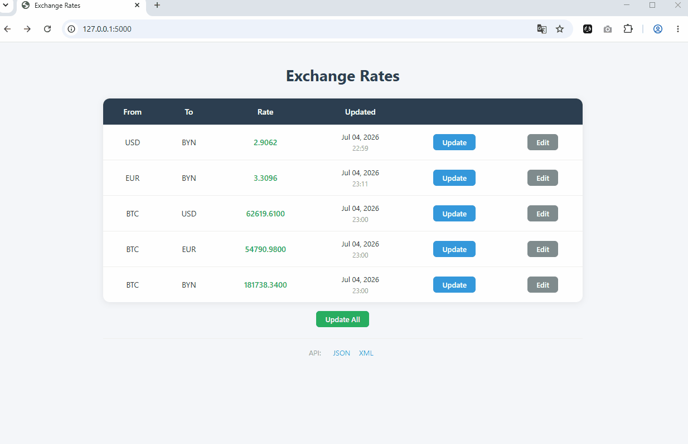
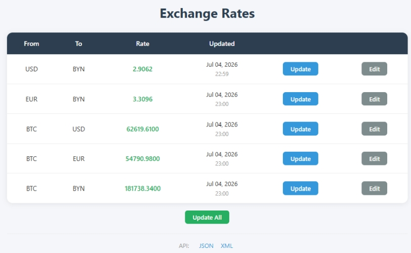
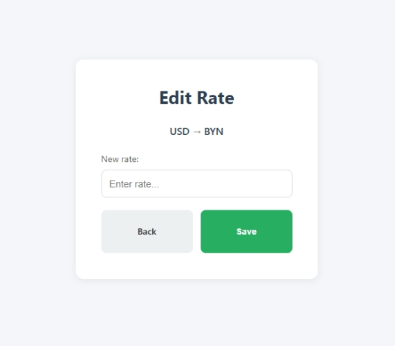
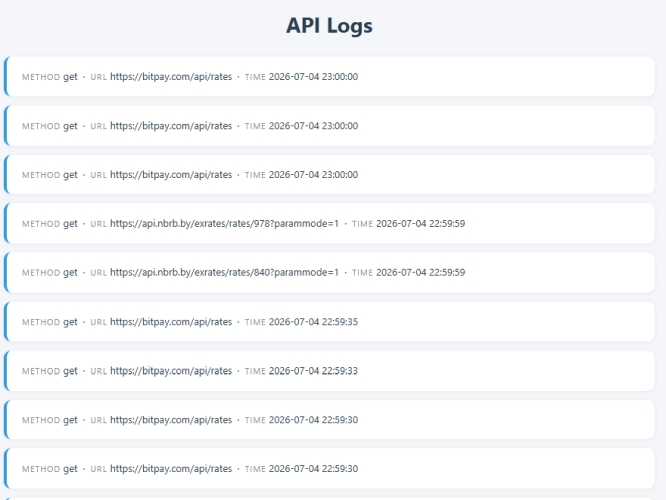

<h1 align="center">Flask XRates</h1>

<p align="center">
  Flask web application for aggregating currency exchange rates from external APIs with a web dashboard and JSON/XML endpoints.
</p>

<p align="center">
   
  
  
  
  
</p>

<p align="center">
  
</p>

<p align="center">
  <sub>
    Demo: dashboard overview, updating exchange rates, editing a rate, and viewing JSON/XML endpoints.
  </sub>
</p>

## Features

- 🌐 HTML dashboard for viewing and managing exchange rates
- 🌍 Fetches exchange rates from external APIs
- 🔄 Automatic background updates with APScheduler
- 📡 JSON and XML API endpoints
- 💾 Stores data in SQLite using Peewee ORM
- 📝 API request and error logging
- 🧪 Unit and integration tests
- 🏗️ Flask Application Factory architecture

---

## Tech Stack

| Category | Technology |
|----------|------------|
| Language | Python 3.12 |
| Backend | Flask 3 |
| ORM | Peewee |
| Database | SQLite |
| Scheduler | APScheduler |
| HTTP Client | Requests |
| Templates | Jinja2 |
| XML | xmltodict |
| Testing | unittest |
| Logging | logging |

---

## Architecture

```text
                External APIs
          ┌─────────────────────┐
          │    NBRB │ BitPay    │
          └─────────┬───────────┘
                    │
                    ▼
             API Client Layer
                    │
                    ▼
            Business Logic Layer
                    │
          ┌─────────┴─────────┐
          ▼                   ▼
      SQLite DB         Logging
          │
          ▼
    HTML • JSON • XML
```

---

## Screenshots

<table align="center" style="border: none;">
  <tr>
    <td align="center" style="padding: 0 10px;"></td>
    <td align="center" style="padding: 0 10px;"></td>
    <td align="center" style="padding: 0 10px;"></td>
  </tr>
  <tr>
    <td align="center"><b>Dashboard</b></td>
    <td align="center"><b>Edit Exchange Rate</b></td>
    <td align="center"><b>Logs</b></td>
  </tr>
</table>

---

## API Endpoints

| Endpoint               | Description                          |
|------------------------|--------------------------------------|
| `/`                    | HTML dashboard                       |
| `/api/xrates/json`     | JSON output                          |
| `/api/xrates/xml`      | XML output                           |
| `/update/all`          | Update all exchange rates            |
| `/update/<from>/<to>`  | Update a single pair                 |
| `/edit/<from>/<to>`    | Edit a single pair *(IP restricted)* |
| `/logs`                | Application logs *(IP restricted)*   |

---


## Getting Started

### Clone repository

```bash
git clone https://github.com/nikolaitolmachev/flask-xrates.git
cd flask-xrates
```

### Create virtual environment

```bash
python -m venv .venv
```

Linux/macOS
```bash
source .venv/bin/activate
```

Windows
```powershell
.venv\Scripts\activate
```

### Install dependencies

```bash
python -m pip install --upgrade pip
pip install -r requirements.txt
```

### Run application

```bash
python runserver.py
```
Open http://127.0.0.1:5000 in your browser.

### Start scheduler

```bash
python -m app.tasks
```

### Run tests

```bash
python -m unittest tests.tests -v
```

---

## Project Goals

This project was originally created while learning Flask and later modernized with a cleaner architecture, improved documentation, testing, and maintainable project structure.

The project showcases practical experience with:

- Flask application factory pattern
- External API integration
- Background task scheduling
- SQLite and Peewee ORM
- JSON/XML endpoints
- Structured logging
- Unit and integration testing

---

## License

This project is licensed under the MIT License. See the [LICENSE](LICENSE) file for details.
